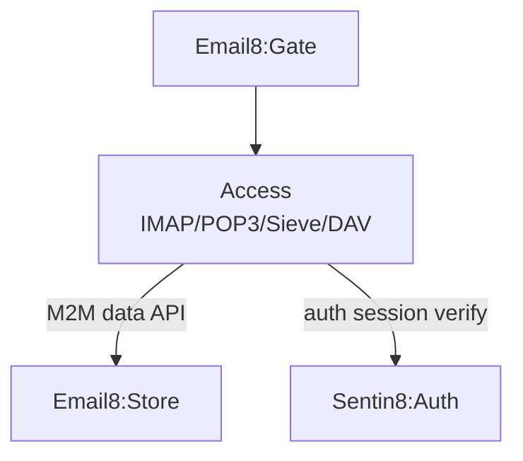

# Sentin8 Email8:Access - Mailbox Protocol Services

## 1. Summary

Email8:Access serves the mailbox access protocols: IMAP (with full
CAPABILITY handling), POP3, ManageSieve, and the CalDAV/CardDAV/
WebDAV collaboration endpoints. It reads mail data through the
Store's data API (certificate-authenticated) and exposes the authenticated
user-plane protocols over the Gate's listeners.

## 2. Architecture

## 3. Key Traits

- Full IMAP session state machine (protocol crates live in
  `email8-sdk` - `imap_proto`, `sieve`, `dav_proto`, `ical`,
  `vcard`).
- M2M: certificate identity (CERTFREE-4V) - the Access workload cert
  presents in the TLS handshake; no bearer token on the Store data API.
- Audit journal (AUDJOUR-1, architecture-principles §6.8): the
  `access.audit_journal` leaf-schema table (migration v2 - the 15-column
  `sentin8_audit::audit_journal_sql` contract, the access leaf schema's
  first object) is drained to Sys `POST /v1/audit` by the shell's
  boot-8c pusher, presenting the `access-audit` workload certificate
  (`sentin8:sys:audit:write`).
- Zero mailbox storage at this layer - Store owns persistence.

See the vertical group docs (`email8/README.md`) for the plane
overview.

---

**Design attribution:** email8:access and its underlying concepts were designed by Hamid Jahanzad <Hamid@Jahanzad.com>.
